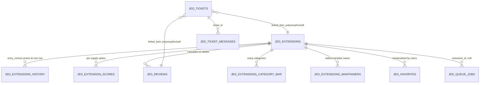

# Data structure

This repo ships two Joomla components that share one database and cross-reference
each other loosely (almost always via plain integer columns, rarely via enforced
foreign keys). This document describes each component's tables, what they're for,
and how they relate.

- [com_jed — the directory](#com_jed--the-directory)
- [com_tickets — the internal workflow queue](#com_tickets--the-internal-workflow-queue)
- [Cross-component relationships](#cross-component-relationships)
- [Known schema inconsistencies](#known-schema-inconsistencies)

---

## com_jed — the directory

Schema: `src/administrator/components/com_jed/sql/install.mysql.utf8.sql`.

### The live/history/review-gate pattern

This is the central design idea of com_jed's data model, and it's not obvious from
the table names alone:

- **`#__jed_extensions`** is the "live" row — what the site actually displays and
  what search/listing queries read from.
- **`#__jed_extensions_history`** stores every submitted version of an extension's
  content (near-identical column set to `#__jed_extensions`), one row per save.
  Nothing is ever updated in place here — every save is a new `INSERT`.
- **`#__jed_extensions.entry_version`** points at the `#__jed_extensions_history.id`
  that the live row currently reflects.

The intended workflow: a developer (frontend) or admin (backend) edit inserts a new
history row. The live row is **not** touched automatically — `entry_version` keeps
pointing at whatever it pointed at before. An admin reviews the diff between the
live row and the new history row (com_jed's backend Extensions list → the
**Pending** column → the **compare** layout) and, if it looks right, clicks
**Approve**, which copies the history row's content into the live row and advances
`entry_version` to match. Until that happens, the extension shows as "pending" in
the admin list — a real reachable state, since neither save path auto-advances
`entry_version` anymore.

`#__jed_extensions_history.active` is a separate, narrower concept: which history
row an admin has flagged as "this is the one" for display in the History modal —
independent of whether it's been approved to the live row.

There is one **deliberate exception** to the review gate: the automated
update-check task (`plugins/task/jed`, see below) writes directly to the live row
when it detects a newer version via an extension's own update server — it still
records the pre-update state as an (inactive) history row for audit purposes, but
doesn't wait for admin approval. Every other save path (backend admin edit,
frontend developer edit, initial extension creation) is review-gated.

### Tables

**`#__jed_extensions`** (the live row) — key columns:
- Identity: `id`, `name`, `alias`, `catid` (single "primary" category, references
  Joomla's native `#__categories` with `extension = 'com_jed'`), `owner`,
  `created_by`.
- Workflow: `state` (Joomla standard: `1` published / `0` unpublished / `2`
  archived / `-2` trashed — matches the `state` field in `forms/extension.xml`),
  `approved` (plain `0`/`1`), `approved_time`, `approved_notes`, `approved_reason`,
  `entry_version` (→ `#__jed_extensions_history.id`, see above).
- Content: `intro`, `description`, `license`, `type` (`free`/`paid`/`freemium`/
  `cloud`), `extension_types` (JSON-ish array of `com`/`mod`/`plugin`/`specific`),
  `joomla_versions` (JSON-ish array of `#__jed_joomla_versions.id`), various `*_url`
  columns (`download_url`, `support_url`, `demo_url`, `documentation_url`,
  `git_url`, `changelog_url`, `developer_url`), `developer_email`, `logo`,
  `overview_image`, `video`, `popular`.
- Update tracking: `uses_updater`, `update_url` (the extension's own update-server
  URL), `last_update_check`, `last_update_check_error` (written by the
  `jed.updatecheck` scheduled task).
- Scores: `score_overall`, `score_functionality`, `score_ease_of_use`,
  `score_support`, `score_documentation`, `score_value_for_money`, `score_count`
  (written by the score recalculation flow, see below — never computed inline).

**`#__jed_extensions_history`** — same shape as `#__jed_extensions` minus
`entry_version`, plus `extension_id` (→ `#__jed_extensions.id`) and `active`.

**`#__jed_extensions_category_map`** (`extension_id`, `catid` composite PK) — the
real many-to-many category assignment (an extension can be listed in more than one
category; `catid` on the live/history rows is just the "primary" one).

**`#__jed_extensions_maintainers`** (`extension_id`, `user_id` composite PK) —
which Joomla users, besides the owner, can edit an extension on the frontend.

**`#__jed_extensions_images`** / **`#__jed_extensions_files`** — uploaded gallery
images / attached files per extension, both with `ON DELETE CASCADE` FKs to
`#__jed_extensions`.

**`#__jed_extension_scores`** — aggregated per-supply-option scores
(`supply_option_id`, a fixed 1/2/3 = Free/Paid/Cloud convention with no backing
lookup table — see the `getSupplyTypes()`/`getReviews()`/`getScores()` methods on
the site's `ExtensionModel`), one row per extension per supply option:
`functionality_score`, `ease_of_use_score`,
`support_score`, `value_for_money_score`, `documentation_score`,
`number_of_reviews`.

**`#__jed_reviews`** — end-user star ratings/text reviews on an extension, plus a
moderated developer-response channel (`developer_response`,
`developer_responded_on`, `developer_response_published`) so the extension's owner
or a maintainer can reply to a review; the reply goes through the same ticket-based
moderation new reviews do. `published`/`developer_response_published` use `-2` as a
soft-delete marker (review author / response author retracting their own
row/response), alongside the normal `0`/`1` unpublished/published states. Has an
`ON DELETE CASCADE` FK to `#__jed_extensions`.

**`#__jed_favorites`** (`id`, `user_id`, `extension_id`, `created`) — a logged-in
user's bookmarked extensions, surfaced on the site Dashboard. `UNIQUE (user_id,
extension_id)` enforces one bookmark per user per extension (the AJAX toggle
endpoint, `Extension` site controller's `addFavorite` task, deletes the row to
un-favorite rather than soft-deleting it). Has `ON DELETE CASCADE` FKs to both
`#__users` and `#__jed_extensions`.

**`#__jed_developers`** (`id`, `user_id`, `developer_name`, `suspicious`) — a
developer identity/reputation record, linked to `#__jed_extensions` only
*transitively*, via `#__jed_extensions.created_by → #__users.id → #__jed_developers.user_id`
(no direct FK, and `user_id` itself has no constraint or index).

**`#__jed_joomla_versions`** (`id`, `label`, `long_label`, `published`) — the
lookup table for Joomla-version-compatibility checkboxes (`#__jed_extensions.joomla_versions`
stores a JSON array of these ids, e.g. `["40","50"]`).

**`#__jed_queue_jobs`** — a generic background-job queue (`type`, `extension_id`,
`history_id`, `payload` JSON, `status`, `attempts`, `result_meta` JSON). Drained by
the `jed.queueworker` scheduled task, dispatched by `type` to a registered
`JobHandlerInterface` (`Jed\Component\Jed\Administrator\Queue\JobHandlerRegistry`).
Current job types:
- `extension.audit` — runs the Docker/phpstan/Claude security-review pipeline for a
  newly-detected version and emails the developer (`Audit/AuditPipeline`).
- `extension.score_recalc` — recomputes one extension's `score_*` columns from
  `#__jed_extension_scores`, always triggered manually (an admin's "Recalculate
  Score" button), never as a scheduled scan of the whole dataset. The actual
  averaging algorithm is delegated to a `jed`-group plugin event
  (`onJedCalculateExtensionScore`, default implementation in
  `plugins/jed/score_avg`) so it can be swapped out without touching this table or
  the queue.

### Scheduled tasks (`plugins/task/jed`, run via com_scheduler)

- `jed.updatecheck` — polls each extension's `update_url`, and on a newer version,
  writes directly to the live row (the one exception to the review gate above) and
  enqueues an `extension.audit` job.
- `jed.queueworker` — drains `#__jed_queue_jobs` of any type each run.

---

## com_tickets — the internal workflow queue

Schema: `src/administrator/components/com_tickets/sql/install.mysql.utf8.sql`.
**No foreign key constraints exist anywhere in this schema** — every relationship
below is an application-level/soft reference only.

A "ticket" here is not a customer-support ticket in isolation — it's the JED team's
generic internal queue for anything that needs staff attention: an extension
submitted for approval, a flagged review, a vulnerability report intake, a Joomla
site issue, etc. Other components open tickets against it via
`Jed\Component\Tickets\Administrator\Traits\TicketHandlingTrait::triggerTicket()`.

**`#__jed_tickets`** — the ticket itself:
- `linked_item_type` (loosely "mirrors" the `TicketType` PHP enum — see the
  inconsistency note below — currently: `Extension` = 1, `Review` = 2, `Other` = 7,
  `DeveloperResponse` = 8; values 3, 4, 5, 6 are retired/unused, the latter three
  having been the VEL report types removed along with com_vel) + `linked_item_id`
  — a polymorphic reference to whatever the ticket is about (`#__jed_extensions.id`,
  `#__jed_reviews.id` for both `Review` and `DeveloperResponse` tickets).
  Each type is handled by a `TicketTypeHandlerInterface` implementation looked up
  via `TicketTypeHandlerRegistry` (`src/administrator/components/com_tickets/src/Ticket/`),
  which is what actually resolves `linked_item_id` into master data for the ticket
  view — not a join against this column.
- `ticket_category_type` (→ `#__jed_ticket_categories.id`), `allocated_group` (→
  `#__jed_ticket_groups.id`), `allocated_to` (→ `#__users.id`, the assigned staff
  member).
- `ticket_origin`, `ticket_status` — free-text/CSV codes, not FK'd to lookup
  tables.
- `ticket_subject`, `ticket_text`, `internal_notes`, `parent_id` (self-reference,
  for follow-up tickets), `state`, `ordering`, standard audit/checkout columns.

**`#__jed_ticket_messages`** — the conversation thread on a ticket (`ticket_id` →
`#__jed_tickets.id`): `subject`, `message`, `message_direction` (`0` = staff/outgoing,
`1` = customer/incoming), `internal` (staff-only note, hidden from the requester).

**`#__jed_ticket_categories`**, **`#__jed_ticket_groups`**,
**`#__jed_ticket_linked_item_types`** — plain lookup tables (id/title/ordering/
state), each with a small seeded set of rows. `#__jed_ticket_linked_item_types` in
particular is stale/unused — see the inconsistency note below.

---

## Cross-component relationships

The only thing tying both components together is `#__jed_tickets`'s polymorphic
`linked_item_type`/`linked_item_id` pair — everything else is component-local.

## Known schema inconsistencies

Worth knowing before relying on "it must be a real FK" assumptions:

- **Inconsistent FK enforcement within com_jed itself**: `#__jed_extensions_images`
  and `#__jed_extensions_files` have real `CONSTRAINT ... FOREIGN KEY ... ON DELETE
  CASCADE` clauses, but `#__jed_extensions_category_map`,
  `#__jed_extensions_maintainers`, and `#__jed_developers.user_id` have none — not
  even an index in the maintainers/developers case. Deleting an extension does
  **not** clean up its category-map or maintainer rows automatically.
- **`#__jed_reviews`'s `(extension_id, created_by)` pair is intentionally not
  unique** even though only one *active* review per user per extension is allowed
  at the application level (`ReviewformModel`) — a soft-deleted review
  (`published = -2`) keeps its row, and the pair must be free to reuse when the
  user writes a new review for the same extension.
- **com_tickets has zero DB-level foreign keys** — every relationship described
  above (`linked_item_id`, `allocated_to`, ...) is enforced only in application
  code, if at all.
- **`#__jed_extension_scores` has no `CREATE TABLE` statement anywhere in
  `install.mysql.utf8.sql`**, despite being the table the "aggregated
  per-supply-option scores" description above refers to, and despite being
  referenced by `sql/migrate_jed3.xml` (`TRUNCATE`/`INSERT`) and read by the
  `extension.score_recalc` queue job. A fresh install would have that queue job
  fail with a missing-table error the first time it runs.
- **`#__jed_ticket_linked_item_types`'s seeded rows don't line up with the
  `TicketType` PHP enum** it's meant to mirror — the row ids are off by one from
  the enum's backing values, and some enum cases (`Other`, `DeveloperResponse`)
  have no corresponding row at all. Nothing in the codebase actually joins
  against this table (ticket master-data resolution goes through
  `TicketTypeHandlerRegistry` instead, keyed directly off the enum), so it
  appears to be vestigial.
- **Not every table with `checked_out`/`checked_out_time` columns actually needs
  them, and not every "editable form" table has them.** Joomla's
  `Table::checkIn()`/`checkOut()` silently no-op when the columns are absent, so
  any checkin/checkout code written against a table missing them would be inert;
  `Ticketmessageform` (site com_tickets) has its checkin/checkout code removed
  accordingly. Tables that do carry real checkout columns: `#__jed_extensions`,
  `#__jed_extensions_history`, `#__jed_extensions_images`, `#__jed_reviews`,
  `#__jed_ticket_categories`, `#__jed_ticket_groups`,
  `#__jed_ticket_linked_item_types`, `#__jed_tickets`.
